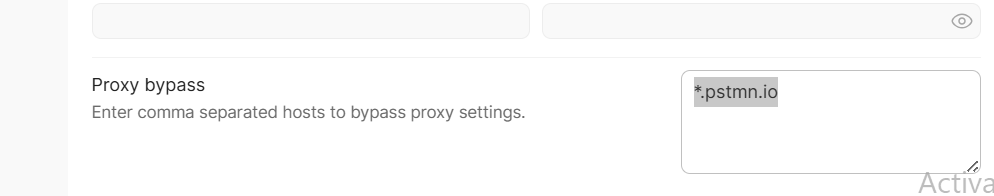

# Activity Rankings API – Test Automation Framework

## Description
Automated API tests for the **Activity Rankings API**. A user enters a city/town and receives a ranked list of 4 activities (Skiing, Surfing, Outdoor Sightseeing, Indoor Sightseeing) for the next 7 days, based on weather.

The framework covers:
- **Positive** – valid location returns 7 days of ranked activities (200)
- **Negative** – ambiguous location (422) and invalid or empty location (404)
- **Edge** – weather service failures (500 / 502 / 503 / 504)

However,results are being published as a HTML Report which having Gherkin Language (Given, When, Then) statements,request and response of the endpoint,assertions (status code/message, error code/messages) and for JSON Schema Validation (using Ajv dependency)


## Tech Stack
| Area | Tool |
|---|---|
| Language | TypeScript (Node.js 20+) |
| BDD / Test Runner | Cucumber.js (Gherkin feature files) |
| HTTP Client | Playwright API Request |
| Contract Validation | AJV (JSON Schema) |
| API Mock | Postman Mock Server |
| Reporting | Cucumber HTML & JSON reports |

## How to Run the Project
1. Install **Node.js 20+**.
2. Install the dependencies:
   ```bash
   npm install
   ```
3. Run the tests:
   ```bash
   npm test                              # all scenarios
   npx cucumber-js --tags @positive      # positive only
   npx cucumber-js --tags @negative      # negative only
   npx cucumber-js --tags @edge          # upstream-failure only
   ```
4. Open the report: `reports/cucumber-report.html`

## How to import Postman Collection
- Download the collection
- Import it in Postman
- Go to settings to bypass proxy : "*.pstmn.io"



